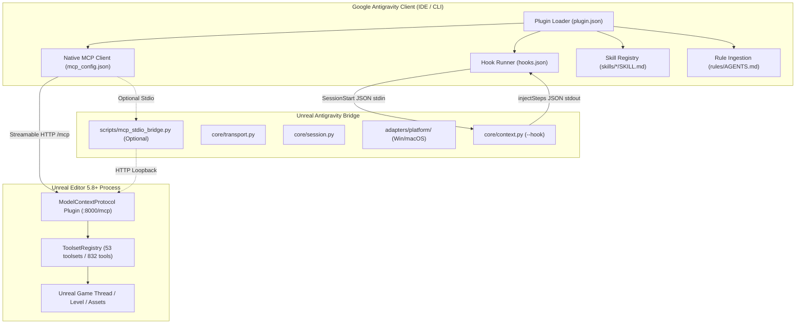

# Antigravity Integration Specification

**Project:** Unreal Engine for Antigravity (`unreal-antigravity-bridge`)  
**Target Client:** Google Antigravity (Antigravity 2.0, Antigravity IDE, `agy` CLI >= 1.5.0)  
**Document Version:** 1.0.0 (ARC 01 — Phase 02)  
**Date:** November 2026  

---

## 1. Overview & Architecture

This specification defines the native Google Antigravity integration architecture for `unreal-antigravity-bridge`. The project bridges Google Antigravity with Unreal Engine 5.8+ through Epic Games' official Model Context Protocol (MCP) server embedded inside Unreal Editor (`ModelContextProtocol` plugin) and registered toolsets (`AllToolsets`).

Neither OpenAI Codex nor Anthropic Claude Code is a runtime dependency. The integration runs natively within Antigravity using standard plugin manifests, native Streamable HTTP MCP transport, pure Python lifecycle hooks, and Antigravity-formatted skills.



---

## 2. Official Antigravity Specifications Reference

This implementation adheres directly to the Google Antigravity plugin and customization specifications:

1. **Plugin Manifest Specification:**
   - Manifest location: Root `plugin.json`.
   - Fields: `name`, `displayName`, `version`, `description`, `author`, `license`, `repository`, `keywords`, `suggestedPrompts`.
   - Validation CLI: `agy plugin validate [target] [--strict] [--json]`.

2. **MCP Configuration Specification:**
   - File location: Root `mcp_config.json`.
   - Schema: `mcpServers` object mapping server identifiers to transport configurations.
   - Primary Transport: Streamable HTTP (`url: "http://127.0.0.1:8000/mcp"`).
   - Secondary Transport: Stdio bridge (`command: "python"`, `args: ["scripts/mcp_stdio_bridge.py"]`).
   - Legacy SSE transports (`/sse`) are deprecated; native `/mcp` Streamable HTTP is standard.

3. **Lifecycle Hooks Specification:**
   - File location: Root `hooks.json` (strictly at plugin root; subfolder locations such as `hooks/hooks.json` are legacy extension staging paths).
   - Top-level schema: Named hook mapping event names to handler arrays.
   - Event: `SessionStart` (flat array of handlers).
   - Handler schema: `type: "command"`, `command: "python core/context.py --hook"`, `timeout: 15`.
   - Protocol: JSON on `stdin` using camelCase (`conversationId`, `workspacePaths`, `cwd`); JSON on `stdout` with `injectSteps` containing `systemMessage`.

4. **Rules Specification:**
   - Location: `rules/AGENTS.md` under plugin root.
   - Ingestion: Loaded automatically into active conversation rules when plugin is enabled.

5. **Skills Specification:**
   - Location: `skills/<skill_name>/SKILL.md`.
   - Frontmatter: YAML header bounded by `---` containing `name` and `description`.
   - Instruction Body: Concise, actionable Markdown instructions, relative file links (`file:///...`), and no legacy vendor references.

---

## 3. Directory Layout

The directory structure conforms to Antigravity's root-layout plugin standard:

```text
unreal-antigravity-bridge/
├── plugin.json               # Native Antigravity plugin manifest
├── mcp_config.json           # Streamable HTTP MCP configuration
├── hooks.json                # Lifecycle hooks configuration
├── rules/                    # Integrated plugin rules
│   └── AGENTS.md             # Antigravity Unreal development conventions
├── skills/                   # Antigravity skills
│   ├── create-toolset/
│   │   └── SKILL.md
│   ├── unreal-game/
│   │   └── SKILL.md
│   ├── unreal-mcp/
│   │   ├── SKILL.md
│   │   └── references/
│   │       ├── operations.md
│   │       └── setup.md
│   ├── unreal-playtest/
│   │   └── SKILL.md
│   └── unreal-skill/
│       └── SKILL.md
├── core/                     # Clean, client-agnostic Unreal engineering core
│   ├── blueprint/
│   ├── indexing/
│   ├── intelligence/
│   ├── context.py            # Hook-compatible workspace discovery
│   ├── session.py            # High-level Unreal MCP session manager
│   ├── transport.py          # Native loopback HTTP JSON-RPC client
│   ├── configure.py          # INI and uproject configuration
│   └── diagnostics.py        # System and engine diagnostics
├── adapters/                 # Platform adapters (Windows / macOS)
│   ├── platform/
│   └── unreal/
├── scripts/                  # CLI utilities and lifecycle helpers
│   ├── doctor.py             # Antigravity diagnostic tool
│   ├── install.py            # Plugin installer and project setup
│   ├── editor_lifecycle.py   # Editor detection, launch, connect, status
│   └── mcp_stdio_bridge.py   # Stdio to HTTP forwarder
├── templates/                # Engine and user setting templates
├── tests/                    # Comprehensive automated test suite
├── docs/                     # Architecture, audit, and user documentation
├── LICENSE                   # MIT License (preserves Epic copyright)
├── README.md                 # Antigravity project overview
└── ROADMAP.md                # 6-Arc project roadmap
```

---

## 4. Manifest Specification (`plugin.json`)

```json
{
  "name": "unreal-antigravity-bridge",
  "displayName": "Unreal Engine for Antigravity",
  "version": "0.1.0-alpha.2",
  "description": "Drive Unreal Engine 5.8+ from Google Antigravity via Epic Games' native Model Context Protocol (MCP) toolsets and specialized game development skills.",
  "author": {
    "name": "Community adaptation of Epic Games' MIT-licensed Unreal Engine skills"
  },
  "license": "MIT",
  "repository": "https://github.com/abhishekbruno/unreal-antigravity-bridge",
  "keywords": [
    "unreal-engine",
    "antigravity",
    "mcp",
    "blueprints",
    "game-development"
  ],
  "suggestedPrompts": [
    "Inspect my current Unreal level and report the available toolsets.",
    "Create a simple playable scene in Unreal Engine using MCP tools, then verify and save it.",
    "Run automated diagnostics on my connected Unreal project and verify MCP status."
  ]
}
```

### Key Field Semantics
- `name`: Must be lowercase kebab-case identifier `unreal-antigravity-bridge`.
- `version`: Follows Semantic Versioning. Phase 02 introduces `0.1.0-alpha.2`.
- `suggestedPrompts`: Exactly three starter prompts displayed in the Antigravity UI.

---

## 5. MCP Configuration (`mcp_config.json`)

Antigravity connects directly to the running Unreal Editor through Streamable HTTP:

```json
{
  "mcpServers": {
    "unreal-mcp": {
      "url": "http://127.0.0.1:8000/mcp"
    }
  }
}
```

### Transport Characteristics
1. **Loopback Binding:** The endpoint is strictly `127.0.0.1:8000/mcp`. Remote or wildcard listening is guarded against.
2. **Dynamic Tool Search:** The native server exposes `list_toolsets`, `describe_toolset`, and `call_tool`. Individual tool signatures are requested on-demand by Antigravity, conserving context window tokens.
3. **Stdio Bridge Alternative:** For environments requiring child process stdio encapsulation, `scripts/mcp_stdio_bridge.py` forwards stdin JSON-RPC requests to `127.0.0.1:8000/mcp`.

---

## 6. Lifecycle Hook Specification (`hooks.json`)

Hooks are declared in the root `hooks.json` file:

```json
{
  "unreal-session-context": {
    "SessionStart": [
      {
        "type": "command",
        "command": "python core/context.py --hook",
        "timeout": 15
      }
    ]
  }
}
```

### Execution Contract

1. **Invocation:** At conversation start, Antigravity executes `python core/context.py --hook` with working directory set to the plugin directory.
2. **Standard Input:** Context metadata is passed via stdin formatted as JSON:
   ```json
   {
     "conversationId": "<uuid>",
     "workspacePaths": ["/path/to/workspace"],
     "cwd": "/path/to/workspace",
     "hookEventName": "SessionStart"
   }
   ```
3. **Discovery:** `core/context.py` inspects `workspacePaths` and `cwd` searching for `.uproject` or engine markers (`GenerateProjectFiles.bat`, etc.).
4. **Standard Output:** If an Unreal project is discovered, it injects project context into the session:
   ```json
   {
     "injectSteps": [
       {
         "systemMessage": {
           "systemMessage": "This workspace is an Unreal Engine project: MyGame.uproject. Prefer Unreal Engine conventions and use the unreal-mcp skill to interact with the running editor."
         }
       }
     ]
   }
   ```
   If no Unreal project is present, it returns `{"injectSteps": []}` with exit code 0.

---

## 7. Migration and Legacy Elimination Matrix

| Legacy Component | Legacy Origin | Antigravity Replacement | Status in Phase 02 |
| :--- | :--- | :--- | :--- |
| `.codex-plugin/plugin.json` | Codex marketplace | `plugin.json` (root) | **Removed** |
| `.agents/plugins/marketplace.json` | Codex marketplace catalog | Native Antigravity plugin loader | **Removed** |
| `AGENTS.unreal-codex.md` | Codex prompt injection | `rules/AGENTS.md` | **Removed & Replaced** |
| `.mcp.json` / `mcp.json` | Duplicate OpenAI schema | `mcp_config.json` | **Consolidated to root** |
| `hooks/hooks.json` | Claude Code hook schema | `hooks.json` (root Antigravity format) | **Standardized** |
| `resolve_codex_binary` | Codex CLI detector | `resolve_client_binary("agy")` | **Generalised & Deprecated** |
| `.codex/config.toml` | Codex configuration | `mcp_config.json` | **Replaced** |
| Claude hook `hookSpecificOutput` | Claude Code JSON output | `injectSteps.systemMessage` | **Replaced** |

---

## 8. Validation and Certification

To validate plugin conformance using the official Antigravity CLI:

```bash
# Antigravity Plugin Validation
agy plugin validate . --strict --json
```

Requirements for PASS certification:
1. Manifest parses without errors.
2. No unknown fields or deprecated extensions.
3. `mcp_config.json` correctly recognized as Streamable HTTP server.
4. `hooks.json` correctly recognized as native lifecycle hook.
5. All 5 skills discovered with valid frontmatter.
